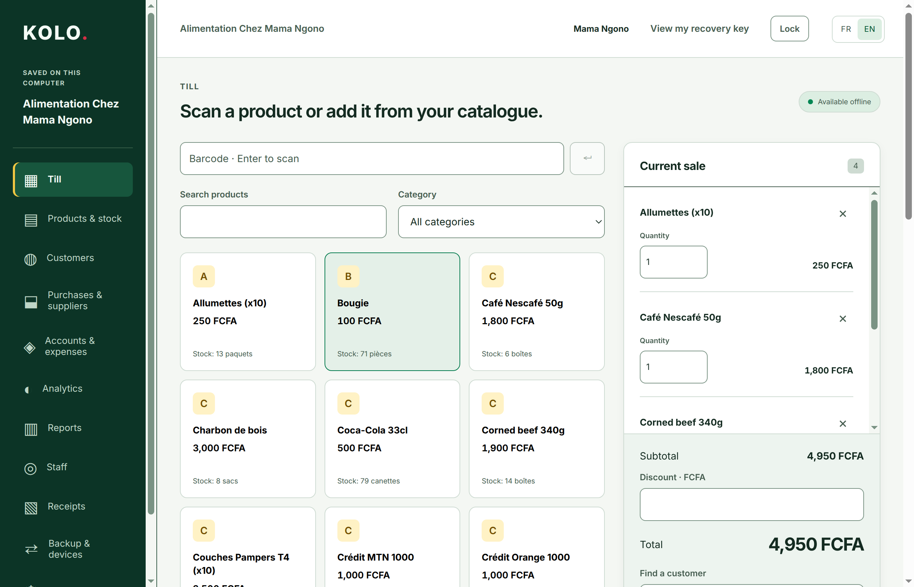
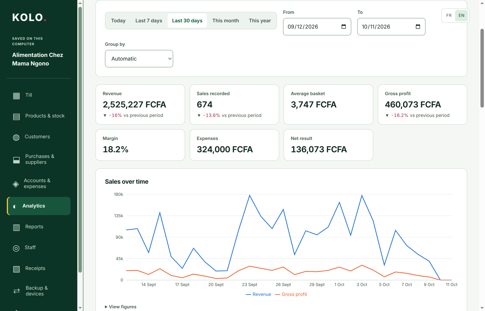
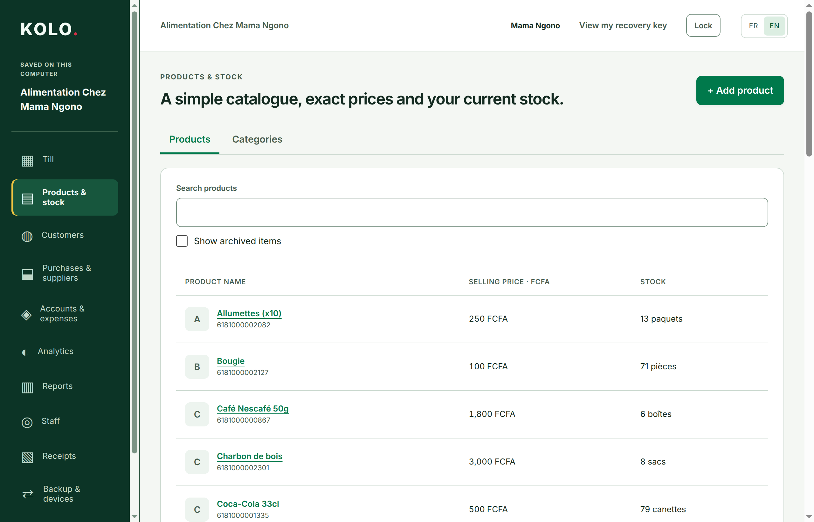
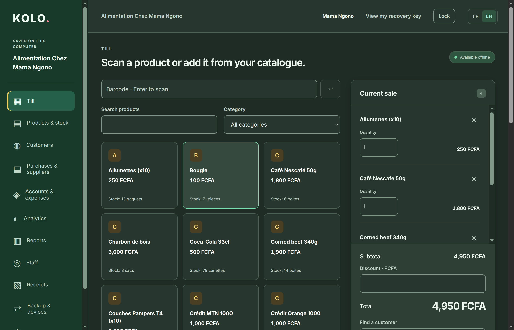
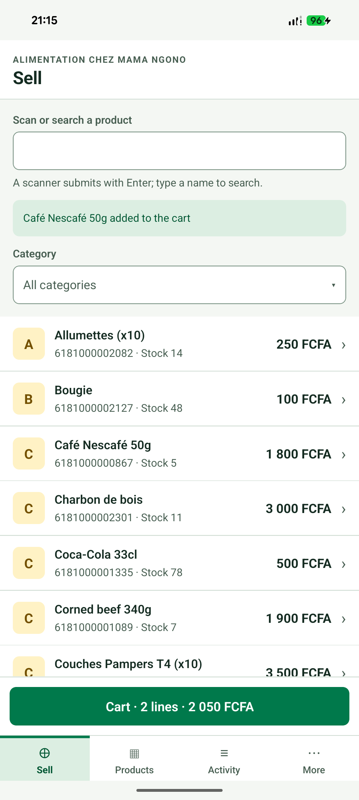
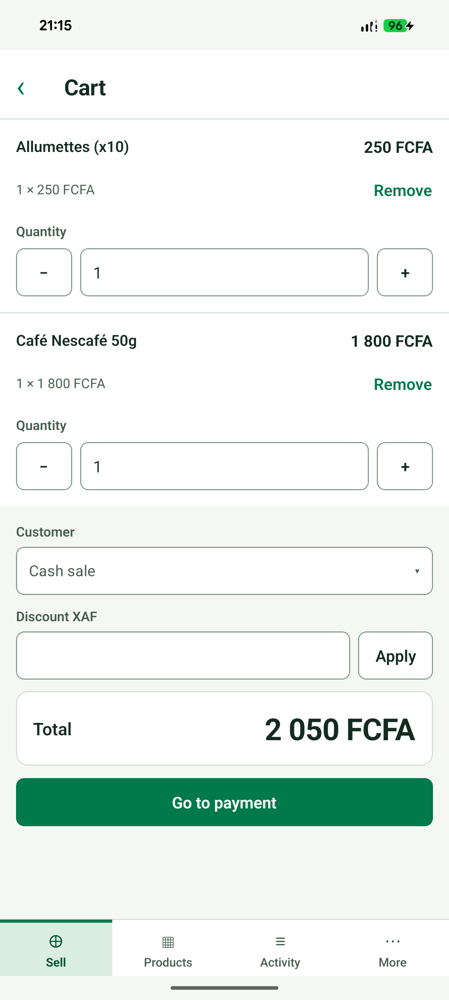
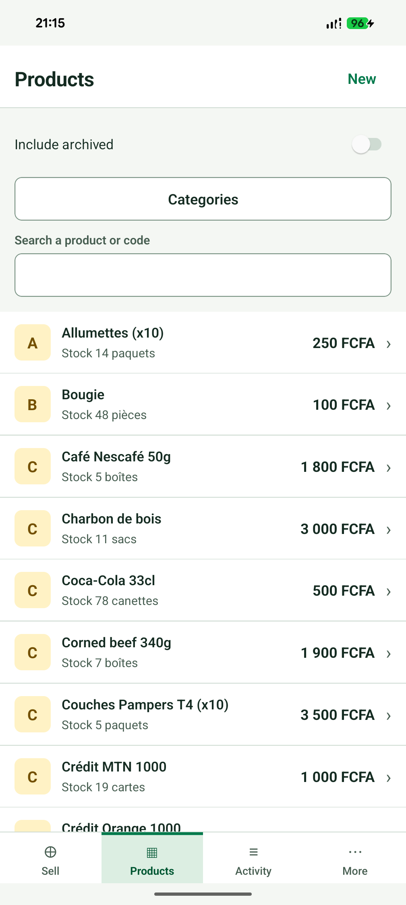

# KOLO

KOLO helps small and medium shops run the business day: selling, stock, customer
credit, suppliers, cash and reports. It is built for shops, supermarkets, boutiques,
pharmacies and wholesalers in Cameroon and across Africa.

## Screenshots

### Desktop

| Analytics | Products and stock |
| --- | --- |
|  |  |

Dark theme

### Android

| Sell | Cart | Products |
| --- | --- | --- |
|  |  |  |

All images show the demo shop. Regenerate desktop images with
`node scripts/capture-desktop-screenshots.mjs`. For Android, connect the demo phone,
open Alimentation Chez Mama Ngono in English on Sell with an empty cart, and run
`node scripts/capture-mobile-screenshots.mjs`. The mobile script selects the light
theme and adds two demo products without completing a sale.

## What it does

- **Sell** at the till by searching products or entering their barcode, with discounts,
  split payments and credit sales.
- **Track stock** with deliveries, counts, adjustments and low-stock alerts.
- **Follow money** owed by customers and to suppliers, cash accounts and expenses.
- **See results** in daily sales, profit and stock reports.
- **Manage staff** with personal codes and role-based permissions.
- **Print or share receipts**, including returns.

## How it works

- **Works without internet.** Every sale and stock movement is saved on the device first.
- **Phone and computer.** An Android app and a Windows desktop app share the same rules.
- **Your data stays yours.** Encrypted backups and file transfers move a shop between devices.
- **French and English**, with amounts in FCFA (XAF).
- **Online sync is optional** and planned: a hosted or self-hosted server that keeps
  several devices in step.

## Status

KOLO is in beta on Windows and Android; both apps cover the full shop workflow.
Barcode scanning (camera and scanners) and online sync are not available yet. Beta
builds appear on the [Releases](https://github.com/vanillaiice/kolo/releases) page.

## For developers

The technical overview, repository layout and commands are in
[docs/README.md](docs/README.md). Product rules live in [SPECIFICATION.md](SPECIFICATION.md).

## License

The apps and shared packages are [GPL-3.0-only](LICENSE). The optional sync server in
`apps/server` is [AGPL-3.0-only](apps/server/LICENSE): anyone who runs a modified copy as
a service must share their changes with its users.
