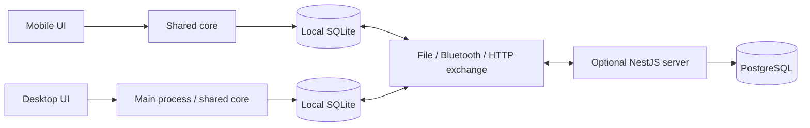

# Architecture and editions

## Product contract

One business app has four delivery modes, not four forks:

| Edition | Local operations | Data exchange | Server dependency |
|---|---|---|---|
| Standalone mobile | All core operations in SQLite | Backup, versioned file bundles; Bluetooth later | None, including first setup |
| Standalone desktop | Same core rules in SQLite | Same backup/exchange formats | None |
| Hosted subscription | Same installed apps | Automatic authenticated cloud exchange | Required only for hosted services |
| Self-hosted | Same installed apps | Automatic exchange against customer endpoint; LAN possible | Customer operates the optional server |

Hosted entitlement expiry pauses hosted services. It does not lock local sales,
reports, backups, or previously recorded data. Pricing, offline license distribution,
and self-host license terms are product decisions to settle before release; architecture
must not require an online license check to open a till.

## Stack and runtime boundaries

| Layer | Choice | Reason |
|---|---|---|
| Shared core/contracts | Strict TypeScript, Zod boundary schemas | Client/server rules and explicit format validation |
| Mobile | Expo/React Native, expo-sqlite, platform keystore | Preserve existing native/offline implementation |
| Desktop | Electron, React, Vite; Node SQLite adapter | Reuse synchronous data layer and TS logic |
| Optional server | NestJS with Express, pg, PostgreSQL | Structured modules/guards/pipes, explicit SQL and transactions |
| Tooling | npm workspaces, Node 24 LTS, TypeScript, Node test runner | One dependency lock and modest tooling |
| Deployment | OCI server image + PostgreSQL | Same app for hosted/self-hosted deployments |

Node/Electron package consumers use compiled JS; Expo uses source via the
`react-native` export condition. No platform framework enters shared code. Server
PostgreSQL repositories remain separate from client SQLite SQL. New pure financial
rules under `core/rules` will be usable everywhere; existing `core/domain/pos` still
depends on arithmetic in `core/data/sales` and is not yet the final layering.

## Local write path

UI command → authenticated local actor/context → operation authorization → pure
validation → SQLite transaction containing business rows and durable event → success.
Transfer occurs later. Reads query local SQLite. Keep cart/filter/dialog state in React;
do not copy the business database into a global store. Desktop owns SQLite in its main
or dedicated utility process; renderer IPC exposes named commands and sanitized results.
Database/file access, printer APIs, and credential storage never cross as generic handles.

## Optional server path

HTTP → authenticated installation/actor → tenant-bound application operation → shared
payload/rule validation → PostgreSQL event journal + domain effects in one transaction
→ per-event acknowledgement. Billing guards govern hosted transfer admission, not core
financial validity. Background jobs may send notifications but must not be required to
finish a financial commit. No queues/Redis are required for the foundation.

## Event model

Maintain immutable business events with origin identity and destination-specific delivery.
Snapshots initialize/restore a device; events merge concurrent histories. Mutable product,
customer, supplier, and account details use `(updated_at, origin_device_id)` last-write-wins;
financial rows/stock movements append. No transport may change event identity or silently
drop a financial rejection. Contradictory content using the same ID is quarantined.

Migration 17 implements immutable signed journal facts, verified replay and destination
receipts. The retained v1 outbox/inbox/HTTP engine serves unconverted legacy shops only;
configured workspaces require v2. F3 supplies encrypted files and native pairing; F6
supplies Nest ingestion. Peer progress is independent of server cursors and cloud flags.

## Deferred choices and measurements

Windows is the first desktop target; Linux/macOS are supported only after packaged
verification. Electron installer tooling/signing and Bluetooth native library choice
are decided in F5/F8 after testing target hardware. Electron has a larger runtime than
a native shell; benchmark startup/memory on a low-cost shop PC before calling it ready.
No Bluetooth API is promised across all phones/PCs until the hardware matrix passes.

Reference docs: [Expo monorepos](https://docs.expo.dev/guides/monorepos/),
[Electron processes](https://www.electronjs.org/docs/latest/tutorial/process-model),
[Nest modules](https://docs.nestjs.com/modules), [Node SQLite](https://nodejs.org/api/sqlite.html).
